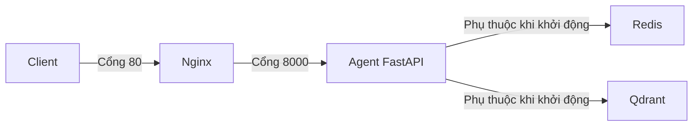

# Day 14 — Mission Answers

## Part 1 — Localhost vs Production

### Exercise 1.1 — Các vấn đề trong bản develop

1. Dòng 17–18: API key mẫu và URL cơ sở dữ liệu được ghi cứng trong code.
   Nếu dùng thông tin thật, chúng có thể bị lộ khi đẩy code lên GitHub.
2. Dòng 33–34: Log in nguyên câu hỏi và giá trị API key.
   Người có quyền đọc log có thể thấy dữ liệu của người dùng hoặc thông tin nhạy cảm.
3. Dòng 42–43: App thiếu endpoint `/health`.
   Hệ thống giám sát thiếu một endpoint dành riêng để kiểm tra app còn hoạt động.
4. Dòng 52: Cổng `8000` được ghi cố định.
   Nếu nền tảng deploy cấp cổng khác, phải sửa code mới đổi được cổng.
5. Dòng 53: App bật `reload=True`.
   Khi file thay đổi, server tự nạp lại. Điều này hữu ích lúc phát triển nhưng
   có thể làm gián đoạn request đang xử lý trên production.

### Exercise 1.2 — Chạy bản develop

- Lệnh: `curl -i -X POST "http://localhost:8000/ask?question=Hello"`
- Kết quả: `HTTP/1.1 200 OK`, response JSON có trường `answer`.
- Bằng chứng: {"answer":"Agent đang hoạt động tốt! (mock response) Hỏi thêm câu hỏi đi nhé."}

### Exercise 1.3 — So sánh với bản production

| Nội dung | Develop | Production | Vì sao quan trọng? |
|---|---|---|---|
| Cấu hình | Cổng `8000` ghi cố định | `config.py` đọc biến môi trường `PORT`, mặc định `8000` | Đổi cổng theo môi trường deploy mà không sửa code |
| Health check | Thiếu `/health` và `/ready` | Có `/health` và `/ready` | Kiểm tra được app còn chạy và đã sẵn sàng nhận request hay chưa |
| Logging | Dùng `print()` và in giá trị key mẫu | Dùng `logging` và ghi thông tin như độ dài câu hỏi | Dễ theo dõi request và giảm việc ghi dữ liệu nhạy cảm vào log |
| Shutdown | Chưa có bước dọn dẹp riêng trong app | Có logic khởi động và tắt trong `lifespan` | Có chỗ để đóng tài nguyên khi app dừng |

Kết quả kiểm tra bản production:

| Request | Kết quả thực tế |
|---|---|
| `GET /health` | `200 OK` |
| `GET /ready` | `200 OK` |
| `POST /ask` với JSON `{"question":"Hello"}` | `200 OK` |

## Part 2 — Docker

### Exercise 2.1 — Đọc Dockerfile

1. **Base image** là `python:3.11`, cung cấp môi trường Python 3.11 cho container.
2. **Thư mục làm việc** là `/app`, được đặt bằng `WORKDIR /app`.
3. **Tại sao copy `requirements.txt` trước `app.py`?** Docker copy
   `requirements.txt` rồi chạy `pip install` trước khi copy mã nguồn.
   Nếu chỉ sửa `app.py`, Docker có thể dùng lại lớp cache đã cài thư viện,
   giúp lần build sau nhanh hơn. Nếu `requirements.txt` thay đổi, Docker
   sẽ chạy lại bước cài thư viện.
4. **`CMD` và `ENTRYPOINT` khác nhau thế nào?** `ENTRYPOINT` đặt chương
   trình chính, còn `CMD` cung cấp lệnh mặc định hoặc tham số mặc định cho
   `ENTRYPOINT`. Dockerfile này dùng `CMD ["python", "app.py"]` để chạy
   `python app.py` khi khởi động container.

### Exercise 2.2 — Build và chạy container develop

Build image và chạy container từ gốc repository:

```bash
docker build -f 02-docker/develop/Dockerfile -t my-agent:develop .
docker run --rm -p 8000:8000 my-agent:develop
```

Trong terminal thứ hai, gửi câu hỏi đến agent:

```bash
curl -i -X POST "http://localhost:8000/ask?question=Hello"
```

Kết quả thực tế:
```text
HTTP/1.1 200 OK

{"answer":"Đây là câu trả lời từ AI agent (mock). Trong production, đây sẽ là response từ OpenAI/Anthropic."}
```

Kết quả `200 OK` xác nhận gọi được endpoint `/ask` trong container qua cổng `8000`. Image `my-agent:develop` có `DISK USAGE` là `1.67 GB`theo kết quả `docker images my-agent`.

### Exercise 2.3 — So sánh kích thước image

Theo cột `DISK USAGE` của `docker images my-agent`, image `develop`
dùng 1,67 GB (khoảng 1.67 GB), còn image `advanced` dùng 240 MB.

Mức giảm xấp xỉ (1.670 − 240) / 1.670 × 100 = 85,6%.

Ở stage `builder`, Docker cài công cụ build như `gcc` và các thư viện Python. Stage `runtime` dùng `python:3.11-slim`, lấy các thư viện đã cài từ `builder` và thêm mã ứng dụng. Công cụ build nằm lại ở stage `builder`, giúp image cuối nhỏ hơn.

### Exercise 2.4 — Docker Compose và Nginx

Stack gồm bốn service. Nginx nhận request ở cổng 80 và chuyển tiếp tới
agent ở cổng 8000 trong mạng nội bộ. Theo cấu hình Compose, agent chờ
Redis và Qdrant vượt qua health check trước khi khởi động.



| Request | Kết quả thực tế | Bằng chứng |
|---|---|---|
| `GET /health` | `200 OK` | `Server: nginx`, JSON có `"status":"ok"` và `"version":"2.0.0"` |
| `POST /ask` với `{"question":"Explain microservices"}` | `200 OK` | `Server: nginx`, JSON có trường `answer` chứa câu trả lời mock |

Docker Hub trả `429 Too Many Requests` khi tải image. Tôi tải Nginx và
Redis từ Amazon ECR Public, tải Qdrant từ `mirror.gcr.io`, rồi gắn lại
các tag theo cấu hình Compose. Tôi dùng lại image agent đã build ở
Exercise 2.3 và khởi động stack với `--no-build --pull never`.

## Part 4 — API Security

### Exercise 4.1 — Xác thực bằng API key

Trong `04-api-gateway/develop/app.py`, `verify_api_key()` kiểm tra header `X-API-Key` với giá trị `AGENT_API_KEY`. Endpoint `/ask` dùng `Depends(verify_api_key)` để kiểm tra key trước khi xử lý câu hỏi.

| Trường hợp | Mã HTTP thực tế | JSON trả về |
|---|---|---|
| Thiếu key | `401 Unauthorized` | `{"detail":"Missing API key. Include header: X-API-Key: <your-key>"}` |
| Key sai | `403 Forbidden` | `{"detail":"Invalid API key."}` |
| Key đúng | `200 OK` | `{"question":"Hello","answer":"Agent đang hoạt động tốt! (mock response) Hỏi thêm câu hỏi đi nhé."}` |

Để đổi key, tôi đặt giá trị mới cho `AGENT_API_KEY`, khởi động lại app và cập nhật header `X-API-Key` ở client.

Kết quả thử sau khi đổi key: Sau khi đổi AGENT_API_KEY và khởi động lại app, gọi /ask với cùng nội dung JSON. Key cũ trả 403 Forbidden với thông báo Invalid API key.. Key mới trả 200 OK và JSON có trường answer.

### Exercise 4.2 — Xác thực bằng JWT

Tôi gửi `POST /auth/token` với tài khoản demo `student`. Server cấp
`access_token`. Tôi lưu token vào biến `TOKEN` trong terminal và gửi
header `Authorization: Bearer <token đã che>` khi gọi `POST /ask`.
Tôi xác nhận token dùng được khi `/ask` trả `200 OK`.

### Exercise 4.3 — Kiểm tra rate limit

Tôi gửi 20 request liên tiếp đến `/ask` bằng cùng tài khoản `student`.

| Request | Kết quả thực tế |
|---|---|
| 1–10 | `200 OK` |
| 11–20 | `429 Too Many Requests` |

Request 10 là request cuối được chấp nhận. Trích response:

```http
HTTP/1.1 200 OK

{"question":"Hello","answer":"Agent đang hoạt động tốt! (mock response) Hỏi thêm câu hỏi đi nhé.","usage":{"requests_remaining":0,"budget_remaining_usd":0.000178}}
```

Request 11 là request đầu tiên bị chặn. Trích response:

```http
HTTP/1.1 429 Too Many Requests
x-ratelimit-limit: 10
x-ratelimit-remaining: 0
retry-after: 59

{"detail":{"error":"Rate limit exceeded","limit":10,"window_seconds":60,"retry_after_seconds":59}}
```

Bản demo dùng cửa sổ trượt 60 giây. `RateLimiter.check()` lưu thời điểm request theo tài khoản và bỏ những mốc đã cũ hơn 60 giây trước khi đếm. `Retry-After: 59` cho biết client nên đợi 59 giây trước khi thử lại.

### Exercise 4.4 — Cost guard

Trong bản demo, `check_budget()` kiểm tra ngân sách trước khi gọi mock LLM. Sau khi có câu trả lời, `record_usage()` cộng số token đầu vào và đầu ra để tính chi phí. Bản demo đặt giới hạn 1 USD/ngày cho mỗi user và 10 USD/ngày cho toàn hệ thống. Theo code, chạm giới hạn của user trả `402`, còn chạm giới hạn toàn hệ thống trả `503`.

Với phương án 10 USD/tháng, lưu tổng chi phí trong Redis theo user và tháng. Trước khi gọi LLM, hệ thống cộng chi phí ước tính của request vào số đã dùng để quyết định có cho chạy hay không. Sang tháng mới, hệ thống dùng một khóa Redis mới.
Rate limit giới hạn số request trong một khoảng thời gian. Cost guard giới hạn số tiền đã dùng, vì mỗi request có thể tốn số token khác nhau.

## Part 5 — Scaling & Reliability

### Exercise 5.1 — Liveness và readiness

| Endpoint | Mã HTTP | Kết quả thực tế |
|---|---|---|
| `GET /health` | `200 OK` | `status: ok`, bộ nhớ sử dụng 43,3% |
| `GET /ready` | `200 OK` | `ready: true`, `in_flight_requests: 1` |

`/health` cho biết agent còn hoạt động. `/ready` cho biết agent đã sẵn sàng nhận request. Bộ đếm `in_flight_requests` tính cả request `/ready` đang được xử lý.

### Exercise 5.2 — Graceful shutdown

Gửi `POST /ask?question=hello` và gửi `SIGTERM` tới tiến trình Uvicorn có PID `21329` sau 0,5 giây. Request đang chạy vẫn hoàn tất với `HTTP/1.1 200 OK` và JSON có trường `answer`.

Log xác nhận server tắt: Finished server process [21329]

### Exercise 5.3 — Stateless design

Mỗi instance FastAPI có bộ nhớ riêng. Nếu lịch sử chỉ lưu trong RAM của instance xử lý request đầu tiên, instance khác có thể không tìm được lịch sử khi nhận request tiếp theo.

Trong bản demo, `save_session()` và `load_session()` dùng khóa `session:<id>` trong Redis. Khi client gửi lại cùng `session_id`, instance nào cũng có thể đọc và cập nhật lịch sử chung.

### Exercise 5.4 — Load balancing

Chạy stack Compose với `--scale agent=3`. Khi gọi `GET http://localhost:8080/health`, nhận `200 OK` từ Nginx và JSON có `"storage":"redis"` cùng `"redis_connected":true`.

Qua trường `served_by`, thấy được Nginx chuyển các request của cùng một session đến ba instance:

| Request | Instance xử lý |
|---|---|
| 1 và 4 | `instance-29e572` |
| 2 và 5 | `instance-fd595e` |
| 3 | `instance-d59003` |

### Exercise 5.5 — Kiểm tra lịch sử hội thoại

Chạy `python test_stateless.py`. Script gửi 5 câu hỏi với cùng session `8f60f234-76ac-40a1-aa06-c2d0213a2fe3`. Khi đọc lại lịch sử, script báo `Total messages: 10`, gồm 5 câu hỏi và 5 câu trả lời.
Kết quả cho thấy ba instance có thể xử lý luân phiên cùng một session mà lịch sử vẫn đầy đủ nhờ Redis.

## Part 6 — Final Project
Checklist Deliverable
   - Dockerfile (multi-stage, < 500 MB)
   - docker-compose.yml (agent + redis)
   - .dockerignore
   - Health check endpoint (GET /health)
   - Readiness endpoint (GET /ready)
   - API Key authentication
   - Rate limiting
   - Cost guard
   - Config từ environment variables
   - Structured logging
   - Graceful shutdown
   - Public URL ready (Railway / Render config)
  Result: 12/12 tiêu chí đạt · 42/42 checks passe
## AI log
- CP1: AI để được hướng dẫn chạy và kiểm tra hai bản agent.
- CP2: Dùng AI để giải thích Docker layer cache, rà soát và xử lý lỗi `429` khi tải image.